# Guia de estudo: conceitos de SaaS no projeto

O SaaS Clínicas aplica 12 conceitos centrais de SaaS multi-tenant, e cada um
está implementado em arquivos que você pode abrir e ler. Este guia liga cada
conceito ao código: o que é, por que existe e onde fica.

Cada seção segue a mesma ordem:

1. **O conceito**, em uma ou duas frases.
2. **Como o projeto resolve**, com as decisões tomadas.
3. **Onde está no código**, com os caminhos para abrir.
4. **Para fixar**, uma pergunta que vale saber responder sem olhar.

Os caminhos começam em `back/` para `saas-clinicas-backend/` e em `front/`
para `saas-clinicas-frontend/`. A última seção traz uma ordem de estudo e
exercícios práticos.

## 1. Multi-tenancy: um banco, muitas clínicas

**O conceito.** Multi-tenancy é servir vários clientes (tenants) com uma única
instalação do sistema, mantendo os dados de cada um separados. É o que torna
um SaaS barato de operar: um deploy, um banco, muitos clientes.

**Como o projeto resolve.** Existem três estratégias clássicas, e o projeto
usa a mais simples de operar:

| Estratégia | Isolamento | Custo de operação | Usada aqui |
| --- | --- | --- | --- |
| Um banco por tenant | Máximo | Alto: N bancos, N migrations | Não |
| Um schema por tenant | Alto | Médio: N schemas no mesmo banco | Não |
| Schema compartilhado com coluna `tenantId` | Depende do código e do banco | Baixo: uma migration para todos | Sim |

A clínica é o tenant. Toda tabela de negócio tem a coluna `tenantId` apontando
para `Clinic.id`, sempre com esse nome, nunca `clinicId`. Unicidades de
negócio são por tenant: o CPF do paciente é único **dentro** da clínica
(`@@unique([tenantId, cpf])`), e o mesmo CPF pode existir em outra sem vínculo.

O preço da estratégia compartilhada é que um `WHERE` esquecido vaza dados de
outro cliente. Por isso as seções 2 e 3 existem.

**Onde está no código.**

- `back/prisma/schema.prisma`: o `tenantId` em `User`, `Patient`,
  `PatientRecord`, `Appointment` e nas tabelas de configuração.
- `back/src/prisma/tenant-extension.ts`: o mapa `TENANT_FIELD`, que diz qual
  coluna liga cada modelo ao tenant (na própria `Clinic`, é o `id`).
- `back/prisma/migrations/*_patients_and_records`: o índice único
  `(tenantId, cpf)`.

**Para fixar.** Por que o e-mail do usuário é único na plataforma inteira, mas
o CPF do paciente é único só dentro da clínica?

## 2. Isolamento em camadas (defesa em profundidade)

**O conceito.** Defesa em profundidade é não depender de uma única barreira:
se uma falhar, a próxima segura. Em multi-tenancy, a barreira que mais falha é
o filtro esquecido numa consulta.

**Como o projeto resolve.** Uma requisição de clínica passa por quatro
barreiras antes de tocar num dado:

1. **O tenant vem do token, nunca do cliente.** O `JwtAuthGuard` lê o
   `tenantId` do JWT. Um `tenantId` enviado no corpo ou na URL é ignorado (há
   teste para isso).
2. **O guard confere o estado no banco a cada requisição.** Usuário inativo
   ou clínica inativa perdem o acesso na hora, sem esperar o token expirar.
3. **Filtro da aplicação.** `prisma.forTenant(tenantId)` devolve um client que
   injeta o `tenantId` em todo `where` e em todo `create`. Quem escreve o
   service não precisa lembrar do filtro.
4. **Row-Level Security no Postgres.** Cada operação roda com
   `SET LOCAL ROLE app_tenant` e `app.tenant_id` definido. As políticas
   `tenant_isolation` só deixam passar linhas com
   `tenantId = app_current_tenant()`. Mesmo um bug no filtro da camada 3 não
   vaza dados.

```mermaid
flowchart TD
    A["Navegador em sorriso.dominio.com<br/>envia os cookies httpOnly; nunca escolhe o tenant"]
    B["Proxy do Nuxt<br/>descarta o X-Clinic-Slug do navegador e envia o do Host"]
    C["Barreiras 1 e 2: JwtAuthGuard<br/>tenantId vem do token; confere usuário e clínica ativos"]
    D["Barreira 3: prisma.forTenant<br/>injeta o tenantId em todo where e create"]
    E["Barreira 4: Row-Level Security<br/>SET LOCAL ROLE app_tenant; política tenant_isolation"]
    F["Só as linhas da própria clínica<br/>tenantId = app_current_tenant()"]
    A --> B --> C --> D --> E --> F
```

A última barreira fica no próprio Postgres: mesmo que as três de cima falhem,
o banco só devolve linhas da clínica definida na transação.

Transações com várias operações usam
`prisma.tenantTransaction(tenantId, async tx => …)`, que faz o ajuste do RLS
uma vez no início. Dentro do callback, só se usa o `tx`.

O RLS também serve para **regras de permissão por tabela**: o papel
`app_tenant` só tem `SELECT` e `INSERT` em `patient_records` (prontuário
imutável) e não tem `DELETE` em `patients` nem em `appointments`.

**Onde está no código.**

- `back/src/auth/jwt-auth.guard.ts`: guard global, lê o token e confere
  usuário e clínica ativos.
- `back/src/prisma/prisma.service.ts`: `forTenant` e `tenantTransaction`.
- `back/src/prisma/tenant-extension.ts`: a extensão do Prisma que injeta o
  filtro e roda o `SET LOCAL ROLE`.
- `back/prisma/migrations/*_row_level_security` e `*_rls_tenant_function`: o
  papel `app_tenant`, a função `app_current_tenant()` e as políticas.
- Toda migration de tabela nova repete o padrão: `ENABLE ROW LEVEL SECURITY`,
  política e `GRANT`s (veja `*_appointments` e o
  [checklist](multi-tenancy.md#checklist-tabela-nova-de-clínica)).

**Para fixar.** Se um service usar `this.prisma.patient.findMany()` sem
`forTenant`, qual camada ainda protege e qual já falhou?

## 3. Identificação do tenant pelo subdomínio

**O conceito.** Antes do login, o sistema precisa saber de qual cliente é
aquela tela. Um SaaS costuma resolver isso com um endereço por tenant:
subdomínio (`sorriso.app.com`), caminho (`app.com/sorriso`) ou domínio próprio.

**Como o projeto resolve.** Cada clínica tem um `slug` único e fixo, que vira o
subdomínio. O domínio vem de `NUXT_PUBLIC_BASE_DOMAIN` (`localhost` em
desenvolvimento):

| Endereço | Área |
| --- | --- |
| `localhost:3000` | só pede o endereço da clínica |
| `admin.localhost:3000` | admin master da plataforma |
| `<slug>.localhost:3000` | a clínica |

O **proxy do Nuxt** é quem traduz o endereço para o backend. Ele lê o `Host`,
descarta qualquer `X-Clinic-Slug` vindo do navegador e envia o seu próprio.
Também recusa rotas de outra área (a API do master no subdomínio de uma
clínica, por exemplo) e fixa o `X-Forwarded-For` com o IP real, usado na
auditoria e no limite de tentativas de login.

No backend, o login **exige** o header e só aceita usuários daquela clínica.
Nas outras rotas, o guard confere o header quando ele vem, para impedir usar a
sessão de uma clínica no endereço de outra.

A tela de login já nasce com o nome, a cor e o logo da clínica, renderizada no
servidor (SSR) a partir de `GET /api/public/clinics/:slug`. É uma das poucas
rotas públicas e só devolve o que a tela precisa.

O slug é fixo por decisão de produto: trocar o endereço quebraria favoritos,
links e e-mails já enviados. Alguns nomes são reservados (`admin`, `www`, `api`
e outros).

**Onde está no código.**

- `front/server/api/[...path].ts`: o proxy (header do slug, área, IP real).
- `front/app/middleware/area.global.ts`: restringe as páginas de cada área no
  navegador.
- `back/src/clinics/slug.ts`: formato, nomes reservados e o nome do header.
- `back/src/clinics/public-clinics.controller.ts`: o tema público da tela de
  login.
- `back/test/subdomains.e2e-spec.ts`: os testes do comportamento por endereço.

**Para fixar.** Por que o proxy descarta o `X-Clinic-Slug` do navegador em vez
de repassá-lo?

## 4. Autenticação e sessões

**O conceito.** Autenticação responde "quem é você". Num SaaS, ela também
carrega o tenant, e por isso o token vira a fonte de verdade de "de qual
clínica é esta requisição".

**Como o projeto resolve.**

- **JWT em cookies httpOnly.** O JavaScript da página não lê o token, o que
  reduz o estrago de um XSS. O access token dura 15 minutos.
- **Duas sessões independentes**, separadas pelo campo `aud` do JWT:

| Sessão | Cookies | `aud` | Carrega |
| --- | --- | --- | --- |
| Clínica | `access_token`, `refresh_token` | `tenant` | `sub` e `tenantId` |
| Master da plataforma | `platform_access_token`, `platform_refresh_token` | `platform` | `sub` |

Um token de clínica nunca abre uma rota do master, e vice-versa. Os cookies
também têm `path` restrito: o refresh da clínica só é enviado para
`/api/auth`, e o do master só para `/api/platform/auth`.

- **Refresh token rotacionado.** O valor é aleatório, o banco guarda só o hash
  SHA-256, e cada uso gera um novo e revoga o anterior.
- **Detecção de reuso.** Se um refresh já usado aparece de novo,
  provavelmente foi roubado. O sistema revoga todas as sessões daquele usuário
  e registra `auth.session_reuse_detected` na auditoria.
- **Senha provisória.** Usuário novo ou com senha redefinida entra com
  `mustChangePassword`. Enquanto isso, só rotas marcadas com
  `@AllowPendingPasswordChange()` respondem.
- **Senhas com argon2** e limite de tentativas de login por IP
  (`@nestjs/throttler`).

A regra de rotação é uma só para as duas sessões, escrita uma vez e
reaproveitada.

**Onde está no código.**

- `back/src/auth/refresh-token-rotation.ts`: rotação, hash e reuso,
  compartilhados.
- `back/src/auth/auth.constants.ts`: nomes e `path` dos cookies das duas
  sessões.
- `back/src/auth/auth-cookies.service.ts`: como os cookies são escritos e
  apagados.
- `back/src/auth/auth.service.ts` e `back/src/platform/platform-auth.service.ts`:
  login, refresh e logout de cada sessão.
- `front/app/composables/useApi.ts`: renova a sessão certa ao receber 401 e
  repete a chamada.

**Para fixar.** O que acontece com a sessão da vítima e com a do atacante
quando o atacante usa um refresh token roubado que a vítima já tinha usado?

## 5. Autorização: papéis e regras por recurso

**O conceito.** Autorização responde "o que você pode fazer". O modelo mais
comum é o RBAC (controle por papéis), e quase sempre ele precisa de um
complemento: regras que dependem do próprio dado, como "só o autor pode".

**Como o projeto resolve.**

- **Seguro por padrão.** O `JwtAuthGuard` é global: toda rota exige sessão de
  clínica, a menos que diga o contrário com `@Public()` ou `@PlatformRoute()`.
  Esquecer um decorator fecha a rota, não abre.
- **Papéis múltiplos.** Um usuário tem um ou mais papéis (`ADMIN`,
  `PROFESSIONAL`, `RECEPTION`) e as permissões somam.
  `@Roles('RECEPTION', 'ADMIN')` exige pelo menos um deles. No código, a
  checagem é sempre `hasRole(user, …)`, nunca uma comparação com um papel
  único.
- **Papéis lidos do banco, não do token.** O guard busca os papéis a cada
  requisição. Tirar o papel de alguém vale na hora, sem esperar os 15 minutos
  do token.
- **Regras por recurso, no service.** Algumas permissões dependem do registro,
  e por isso não cabem num decorator:
    - adendo no prontuário: só o autor do registro ou um admin;
    - agenda: recepção e admin mexem em qualquer agendamento, e o profissional
      só nos próprios (`NOT_OWN_APPOINTMENT`);
    - equipe: ninguém tira o próprio papel de admin, e a clínica nunca fica
      sem um admin ativo.
- **O front só esconde, o back decide.** O front esconde botões pelo papel
  (`useAuth().hasRole`), mas a regra que vale é a do backend.

**Onde está no código.**

- `back/src/auth/roles.guard.ts` e `back/src/auth/decorators/`: `@Roles`,
  `@Public`, `@PlatformRoute`, `@AllowPendingPasswordChange`,
  `@AllowDuringDeletion`.
- `back/src/auth/auth-user.ts`: `hasRole`.
- `back/src/patients/patient-records.service.ts`: a regra do autor do adendo.
- `back/src/appointments/appointments.service.ts`: `assertCanManage`.
- `back/test/roles.e2e-spec.ts`: papéis múltiplos e mudança de papel valendo na
  hora.

**Para fixar.** Por que a regra "o profissional só remarca os próprios
agendamentos" não pode ser um `@Roles` no controller?

## 6. Plano de controle: o admin master

**O conceito.** Todo SaaS tem duas metades: o **plano de dados**, onde os
clientes trabalham, e o **plano de controle**, onde o dono da plataforma
gerencia os clientes (criar, suspender, dar suporte). As duas precisam de
identidades e permissões separadas.

**Como o projeto resolve.**

- **Identidade separada.** O master fica na tabela `PlatformAdmin`, sem
  `tenantId`: ele não pertence a nenhuma clínica. Tem sessão própria (seção 4)
  e entra por `admin.<domínio>`.
- **Onboarding feito pela plataforma.** Não há cadastro público. O master cria
  a clínica, o horário e o primeiro administrador numa única transação. O
  admin recebe uma senha provisória e troca no primeiro acesso.
- **Ciclo de vida do tenant.** O master ativa e inativa clínicas. Inativar
  revoga todas as sessões da equipe, e o guard bloqueia o acesso na requisição
  seguinte. A mesma alavanca serve, no futuro, para suspender por falta de
  pagamento.
- **Suporte sem ver dados sensíveis.** O master gerencia a equipe de qualquer
  clínica (criar usuário, redefinir senha, mudar papéis), mas **não vê
  pacientes**: só a quantidade. Na LGPD, a clínica é a controladora dos dados
  de saúde.
- **O tenant vem da URL só aqui.** Nas rotas `/api/platform/clinics/:id/...`, o
  `tenantId` vem do parâmetro, porque o master age em nome de uma clínica
  escolhida. Em todo o resto, vem do token.
- **Primeiro master por linha de comando.** `npm run platform:create-admin`
  cria ou reativa um master, sem tela pública para isso.

**Onde está no código.**

- `back/src/platform/`: controllers do master (clínicas, usuários, auditoria,
  autenticação).
- `back/src/clinics/clinics.service.ts`: `create` (clínica + horário + admin
  numa transação) e `setActive`.
- `front/app/pages/master/`: telas do master, com `layout: 'master'` e
  `middleware: 'platform-auth'`.
- `back/scripts/create-platform-admin.ts`: o script de criação do master.

**Para fixar.** Por que inativar uma clínica revoga os refresh tokens, se o
guard já confere a clínica ativa a cada requisição?

## 7. Configuração e personalização por tenant

**O conceito.** Clientes de um mesmo SaaS querem que o sistema pareça e
funcione do jeito deles, sem que você mantenha uma versão por cliente. A saída
é guardar as diferenças como **dados de configuração do tenant**, lidos em
tempo de execução.

**Como o projeto resolve.** Tudo o que varia por clínica é dado, e o mesmo
código serve todas:

| Configuração | Onde fica | Quem edita | Efeito |
| --- | --- | --- | --- |
| Nome | `clinics.name` | admin ou master | menu e tela de login |
| Endereço (`slug`) | `clinics.slug` | master, só na criação | subdomínio |
| Cor principal | `clinic_brandings.primaryColor` | admin ou master | tema do Vuetify |
| Logo | `clinic_brandings.logo` | admin ou master | menu e tela de login |
| Fuso horário | `clinics.timeZone` | admin | agenda, "aberta agora" |
| Duração padrão da consulta | `clinics.defaultAppointmentMinutes` | admin | sugestão no agendamento |
| Horário de funcionamento | `clinic_business_hours` | admin | grade da agenda, encaixe |

Algumas decisões que valem estudar:

- **Validação que protege o produto.** A cor só é aceita com contraste mínimo
  de 4,5:1 com o branco (WCAG AA), para que nenhuma clínica deixe o sistema
  ilegível. O logo é validado pelos bytes do arquivo, não pelo `Content-Type`,
  e SVG é recusado porque pode conter scripts.
- **Dados pesados em tabela separada.** O logo fica em `clinic_brandings`, fora
  de `clinics`, para não ser carregado em toda consulta da clínica.
- **Sem "piscar".** A cor vem no `/auth/me` e fica em cache no navegador, para
  a tela não abrir na cor padrão e trocar depois.
- **Tempo sempre no fuso do tenant.** O banco guarda instantes em UTC. A
  conversão para o relógio da clínica acontece nas bordas: no backend, para
  conferir o expediente, e no front, para desenhar a grade. A API só aceita
  horários com fuso explícito (`-03:00` ou `Z`).

**Onde está no código.**

- `back/src/clinics/clinic-branding.service.ts` e `back/src/clinics/branding.ts`:
  cor, logo e validação pelos bytes.
- `back/src/common/color.ts`: o cálculo de contraste.
- `back/src/clinics/clinics.service.ts`: `updateScheduleSettings` e
  `updateBusinessHours`.
- `back/src/appointments/business-hours.ts`: expediente conferido no fuso da
  clínica.
- `front/app/composables/useBranding.ts` e `front/app/utils/time-zone.ts`.

**Para fixar.** Por que guardar o fuso na clínica, e não usar o fuso do
navegador de quem está vendo a agenda?

## 8. Auditoria

**O conceito.** Um log de auditoria registra quem fez o quê, quando e de onde.
Num SaaS que guarda dados de saúde, ele é exigência de segurança e de LGPD:
precisa ser confiável, ou seja, ninguém pode alterá-lo depois.

**Como o projeto resolve.**

- **Na mesma transação da ação.** `audit.log(tx, 'recurso.verbo', { target })`
  roda dentro da transação que faz a mudança. Se a ação falhar, o log some
  junto. Se o log falhar, a ação não acontece. Não existe ação sem registro.
- **Ator e IP vindos do contexto.** O service não passa quem fez a ação: o
  `nestjs-cls` guarda o usuário (ou o master, ou o sistema) e o IP de cada
  requisição, e o `AuditService` lê de lá.
- **Imutável no banco.** Um trigger em `audit_logs` recusa `UPDATE` e
  `DELETE`. Só as rotinas de LGPD abrem uma exceção, com
  `SET LOCAL app.audit_maintenance = 'on'` dentro da própria transação.
- **Catálogo fechado de ações.** Toda ação nova entra em `audit-actions.ts`
  (backend) e ganha tradução no front. O nome segue `recurso.verbo_no_passado`,
  como `patient.created` ou `appointment.status_changed`.
- **Metadata sem dados pessoais.** O `metadata` leva ids, papéis, status e
  nomes de campos alterados, nunca e-mail, nome ou texto livre. O texto
  clínico do prontuário, a observação e o motivo de cancelamento do
  agendamento nunca vão para o log.
- **Leitura também é auditada quando importa.** Abrir a ficha de um paciente
  registra `patient.viewed`.
- **Sobrevive ao tenant.** `audit_logs.tenantId` não tem chave estrangeira, de
  propósito: quando a clínica é excluída, os logs ficam, anonimizados.

**Onde está no código.**

- `back/src/audit/audit.service.ts` e `back/src/audit/audit-context.ts`:
  gravação e contexto do ator.
- `back/src/audit/audit-actions.ts` e `front/app/utils/audit-actions.ts`:
  catálogo e tradução.
- `back/prisma/migrations/*_audit_logs_and_clinic_deletion`: o trigger
  `audit_logs_immutable`.
- `front/app/pages/painel/atividades.vue` e `front/app/pages/master/atividades.vue`:
  as telas de histórico.

**Para fixar.** O que daria errado se o log fosse gravado depois do `commit`
da ação, fora da transação?

## 9. LGPD e o fim da vida de um tenant

**O conceito.** Um SaaS precisa saber **sair** de um cliente tanto quanto
entrar: devolver os dados (portabilidade), apagar tudo quando pedido e provar
que apagou. Com dados de saúde, isso é obrigação legal, não detalhe.

**Como o projeto resolve.**

- **Exportação.** O admin baixa um JSON com a clínica, a equipe, o histórico e
  os dados de saúde (pacientes, prontuário e agenda). O master também exporta,
  mas sem os dados de saúde, só a contagem.
- **Exclusão em duas etapas.** O admin solicita, digitando o nome da clínica
  para confirmar. O master confirma ou recusa. Uma pessoa sozinha não apaga
  uma clínica inteira por engano.
- **Carência de 30 dias, somente leitura.** Depois da confirmação, a clínica
  continua acessível para consulta e exportação. O guard recusa todo método
  que não seja `GET`, `HEAD` ou `OPTIONS` com `403 CLINIC_READ_ONLY`. Rotas que
  precisam funcionar mesmo assim (cancelar a exclusão, trocar a senha) levam
  `@AllowDuringDeletion()`. O admin ou o master podem cancelar até o último
  dia.
- **Purge agendado.** O `PurgeService` roda todo dia às 3h. Ele apaga as
  clínicas com a data vencida, em cascata, e anonimiza os logs delas (o nome
  do ator vira um rótulo genérico).
- **Minimização.** IP e user agent dos logs são apagados depois de 180 dias
  (`AUDIT_IP_RETENTION_DAYS`).
- **Inativar, não apagar.** Pacientes são inativados, nunca apagados, porque o
  prontuário precisa ser guardado. O apagamento real só acontece na exclusão
  da clínica inteira.

**Onde está no código.**

- `back/src/privacy/privacy.service.ts`: exportação e as transições do pedido
  de exclusão.
- `back/src/privacy/purge.service.ts`: o cron de exclusão e de limpeza de IP.
- `back/src/privacy/deletion-status.ts`: o status calculado (`NONE`,
  `REQUESTED`, `SCHEDULED`).
- `back/src/auth/jwt-auth.guard.ts`: o bloqueio `CLINIC_READ_ONLY`.
- `front/app/components/DeletionCountdownBanner.vue`: o aviso de quantos dias
  faltam.

**Para fixar.** Por que os logs da clínica excluída são anonimizados em vez de
apagados junto com ela?

## 10. Integridade de dados e concorrência

**O conceito.** Uma regra de negócio que só existe no código da aplicação
falha quando duas requisições chegam juntas: as duas checam, as duas veem
"livre", as duas gravam. Regras que não podem ser quebradas devem morar no
banco, que é o único lugar que vê todas as escritas em ordem.

**Como o projeto resolve.**

- **Agenda sem sobreposição.** Uma *exclusion constraint* (extensão
  `btree_gist`) impede que o mesmo profissional tenha dois agendamentos com
  intervalos `tsrange(startsAt, endsAt)` sobrepostos. Ela só vale para
  agendados, confirmados e realizados: cancelados e faltas liberam o horário.
  O service não checa antes de gravar. Ele tenta e traduz a violação
  (`23P01`) para `409 APPOINTMENT_CONFLICT`. Um teste dispara duas marcações
  simultâneas e confere que só uma passa.
- **Intervalo semiaberto.** O intervalo é `[início, fim)`: uma consulta que
  termina às 09:00 e outra que começa às 09:00 não conflitam.
- **Unicidade por tenant.** `(tenantId, cpf)` em pacientes e
  `(tenantId, weekday)` no horário de funcionamento. A violação vira
  `CPF_IN_USE`.
- **CHECKs simples.** `endsAt > startsAt` e a duração padrão entre 5 e 240
  minutos ficam também como `CHECK` no banco, com os mesmos limites do DTO.
- **Imutabilidade.** O prontuário não tem `UPDATE` nem `DELETE` para o papel da
  aplicação. Correções entram como adendo, com `amendsId` apontando para o
  registro original.
- **Máquina de estados.** O status do agendamento só avança por transições
  permitidas (`SCHEDULED → CONFIRMED → COMPLETED`, por exemplo), e cancelado,
  realizado e falta são finais. A tabela de transições é uma função pura,
  testada sozinha.

**Onde está no código.**

- `back/prisma/migrations/*_appointments/migration.sql`: a constraint
  `appointments_no_overlap` e o `CHECK` de horário.
- `back/src/appointments/appointments.service.ts`: `withOverlapConflict`, que
  traduz o erro do banco.
- `back/src/appointments/appointment-status.ts`: as transições de status.
- `back/test/appointments.e2e-spec.ts`: o teste de duas marcações simultâneas.

**Para fixar.** Por que "consultar se o horário está livre e depois inserir"
não é seguro, mesmo dentro de uma transação com o isolamento padrão do
Postgres?

## 11. Contrato entre front e back

**O conceito.** O front e o back evoluem juntos, mas são programas separados.
Um contrato explícito (formatos, códigos de erro, como renovar a sessão) evita
que uma mudança de um lado quebre o outro em silêncio.

**Como o projeto resolve.**

- **Códigos de erro estáveis.** Erros de regra de negócio têm um `code` fixo,
  como `CPF_IN_USE` ou `APPOINTMENT_CONFLICT`, além da mensagem técnica em
  inglês. O front traduz o código para português. A mensagem técnica pode
  mudar à vontade, o código não.
- **O status HTTP diz a natureza do erro.** `400` é dado inválido, `403` é
  falta de permissão, `404` é inexistente (inclusive o que existe em outra
  clínica: o sistema não confirma que existe), `409` é conflito com o estado
  atual, e `422` é pedido válido que precisa de confirmação. O encaixe na
  agenda usa o `422`: a tela mostra o aviso e reenvia com
  `allowOutsideBusinessHours: true`.
- **Validação na entrada.** Um `ValidationPipe` global com `class-validator`
  recusa campos desconhecidos (`forbidNonWhitelisted`) e normaliza os
  conhecidos: tira espaços, deixa o e-mail em minúsculas, deixa o CPF só com
  dígitos.
- **Um cliente de API só.** `useApi()` faz toda chamada do front. Ao receber
  `401`, ele renova a sessão certa (clínica ou master) e repete a chamada. Se
  várias chamadas recebem `401` ao mesmo tempo, só um refresh é feito e todas
  esperam por ele, o que importa porque o refresh token é rotacionado. A
  página não sabe que o token expirou.
- **Front e back no mesmo commit.** Uma mudança de contrato entra nos dois
  lados de uma vez, para o histórico nunca ter um lado quebrado.

**Onde está no código.**

- `back/src/common/api-error.ts`: a lista de códigos e os helpers
  `badRequest`, `conflict`, `forbidden`, `unprocessable`.
- `front/app/utils/api-errors.ts`: a tradução de cada código.
- `back/src/common/validation/decorators.ts`: os normalizadores e validadores
  próprios (CPF, CNPJ, fuso IANA).
- `back/src/app/configure-app.ts`: o `ValidationPipe` global e o prefixo
  `/api`.
- `front/app/composables/useApi.ts`: a renovação automática.

**Para fixar.** Por que buscar um paciente de outra clínica responde `404`, e
não `403`?

## 12. Qualidade: provar o isolamento

**O conceito.** Num SaaS multi-tenant, o bug mais grave é um cliente ver dados
de outro. Esse comportamento não pode depender de revisão de código: precisa
de testes que falhem se o isolamento quebrar.

**Como o projeto resolve.**

- **Testes de isolamento explícitos.** Equipe, pacientes e agenda têm testes
  que criam duas clínicas e conferem que a segunda não lista, não lê e não
  altera o que é da primeira. Inclui tentar usar o id de um paciente ou
  profissional de outra clínica.
- **Testes do RLS direto no banco.** Um teste ignora a aplicação e conversa
  com o Postgres como `app_tenant`, para provar que a segunda camada segura
  sozinha.
- **E2E contra um banco real.** Os testes e2e sobem a aplicação inteira e usam
  o banco `saas_clinicas_test`, com as migrations de verdade. Constraint,
  trigger e RLS são testados como rodam em produção, sem mocks.
- **Regras puras testadas sozinhas.** Transições de status, cálculo de
  expediente no fuso, validação de slug, contraste de cor e rotação de refresh
  token têm testes unitários rápidos.
- **CI a cada push.** O GitHub Actions roda lint, testes unitários, e2e e build
  no backend, e lint e typecheck no front.
- **Seed de desenvolvimento.** `make seed` cria o master, a clínica `demo`,
  dois profissionais, uma recepcionista e pacientes fictícios. Ela se recusa a
  rodar em produção.

**Onde está no código.**

- `back/test/tenant-isolation.e2e-spec.ts` e
  `back/test/row-level-security.e2e-spec.ts`: as duas camadas de isolamento.
- `back/test/appointments.e2e-spec.ts`: o bloco `tenant isolation` da agenda.
- `back/test/utils.ts`: `signUpClinic`, `createUser` e `resetDatabase`, os
  ajudantes de cenário.
- `.github/workflows/ci.yml`: o pipeline.
- `back/prisma/seed.ts`: a seed.

**Para fixar.** Ao criar uma tabela nova de clínica, quais três coisas na
migration e qual teste você precisa escrever?

## O que um SaaS em produção ainda teria

O projeto cobre a base de um SaaS multi-tenant, mas faltam os temas abaixo,
todos registrados no [roadmap](roadmap.md). Cada um é um bom próximo conceito
para estudar, porque se apoia no que já existe.

| Tema | O que é | Onde se apoiaria no projeto |
| --- | --- | --- |
| Planos e cobrança | assinatura com provedor de pagamento, limites por plano, período de teste | a inativação de clínica vira suspensão por falta de pagamento |
| Observabilidade por tenant | logs estruturados com `tenantId`, métricas e alertas por clínica | o `nestjs-cls` já carrega o contexto de cada requisição |
| Limite de requisições por tenant | impedir que uma clínica sobrecarregue as outras (*noisy neighbor*) | hoje o `@nestjs/throttler` limita só o login, por IP |
| Convite por e-mail e "esqueci minha senha" | link com validade e token de uso único, no lugar da senha provisória repassada à mão | a mesma ideia de token aleatório com hash do refresh token |
| Agenda própria por profissional | dias, horários e bloqueios diferentes dos da clínica | o cálculo de expediente no fuso já existe |
| LGPD de pacientes | base legal, consentimento, retenção do prontuário por 20 anos | exportação e purge já existem para a clínica |
| Aceite versionado de termos | registro de qual versão dos termos cada clínica aceitou | a auditoria pode registrar o aceite |

Há também duas pendências da agenda: inativar um paciente ou profissional não
cancela os agendamentos futuros dele, e não é possível registrar um
agendamento retroativo.

## Roteiro de estudo

Estude na ordem em que uma requisição atravessa o sistema: primeiro de quem é
o dado, depois quem pede, depois o que pode e por fim o que fica registrado.

**Ordem sugerida**

1. Multi-tenancy e isolamento (seções 1 e 2). Leia `tenant-extension.ts` linha
   por linha e a migration `*_row_level_security`.
2. Subdomínio e autenticação (seções 3 e 4). Siga um login do proxy até o
   cookie.
3. Autorização (seção 5). Compare uma regra de `@Roles` com uma regra no
   service.
4. Plataforma e configuração (seções 6 e 7).
5. Auditoria e LGPD (seções 8 e 9).
6. Integridade, contrato e testes (seções 10 a 12).

**Exercícios práticos**

- [ ] Rode `npm run test:e2e` e depois comente a linha
  `Appointment: 'tenantId'` em `tenant-extension.ts`. Quais testes falham, e
  por que o RLS ainda segura parte deles?
- [ ] No `psql`, rode `SET ROLE app_tenant;` sem definir `app.tenant_id` e faça
  `SELECT * FROM patients;`. Explique o resultado.
- [ ] Faça login como `ana@demo.com` e tente, pelo Insomnia, cancelar um
  agendamento do Dr. Bruno. Qual código volta?
- [ ] Abra duas abas, marque o mesmo horário para o mesmo profissional nas
  duas e confirme quase juntas. Onde a segunda é barrada?
- [ ] Tente um `UPDATE audit_logs SET action = 'x';` no `psql`. Leia a
  mensagem do trigger.
- [ ] Implemente a pendência "inativar um profissional cancela os agendamentos
  futuros dele": transação, auditoria de cada cancelamento e um teste e2e.

**Perguntas de revisão**

1. Quais são as quatro barreiras entre uma requisição e os dados de outra
   clínica?
2. Por que os papéis não vão no JWT?
3. O que diferencia o plano de controle do plano de dados neste projeto?
4. Que três itens toda migration de tabela nova de clínica precisa ter?
5. Quando usar `409` e quando usar `422`?
6. O que o sistema faz quando um refresh token já usado reaparece?
