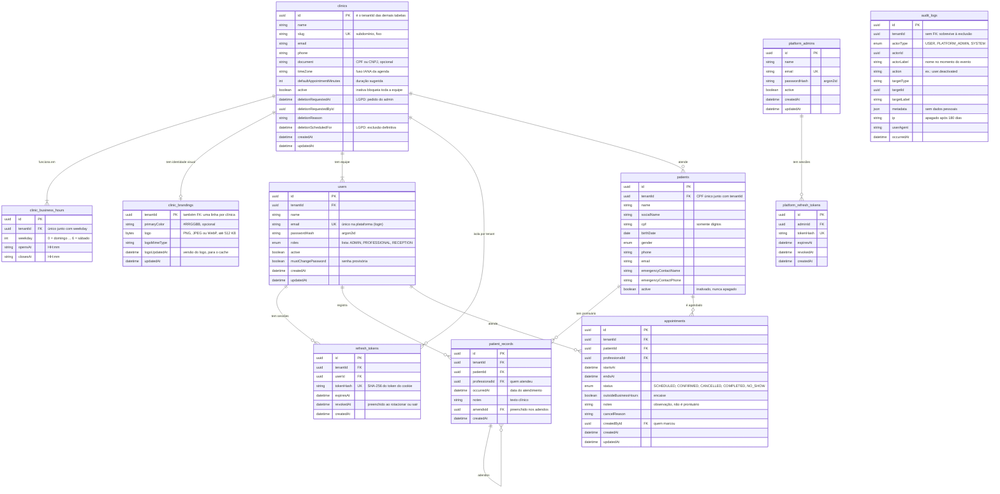

# Modelo de dados

Como ler o diagrama:

- **`clinics`** é o tenant. As outras tabelas da clínica apontam para ela pela
  coluna `tenantId`. Uma clínica com `active = false` bloqueia o acesso de toda
  a equipe.
- **`clinic_business_hours`** tem uma linha por dia de funcionamento. O par
  (`tenantId`, `weekday`) é único, então não há dois horários para o mesmo dia.
  Toda clínica tem pelo menos um dia.
- **`clinic_brandings`** guarda a cor principal e o logo, com no máximo uma
  linha por clínica. Fica separada de `clinics` para que os bytes do logo não
  sejam lidos em toda consulta da clínica. O formato do logo é conferido pelos
  primeiros bytes do arquivo, e não pelo `Content-Type`. SVG não é aceito,
  porque pode conter scripts.
- **`users`** é a equipe. Toda clínica tem pelo menos um administrador ativo:
  o sistema não deixa inativar o último.
- **`refresh_tokens`** guarda as sessões. Cada linha pertence a um usuário e
  também leva o `tenantId`, para ser filtrada pela clínica como as demais.
- **`platform_admins`** e **`platform_refresh_tokens`** são do admin master. Não
  têm `tenantId`, porque não pertencem a nenhuma clínica.
- **`patients`**: o par (`tenantId`, `cpf`) é único. O mesmo CPF pode existir
  em outra clínica, sem nenhum vínculo entre os cadastros, e um usuário de uma
  clínica pode ser paciente de outra. Pacientes são inativados, nunca
  apagados.
- **`patient_records`** é o prontuário. É **imutável**: não há edição nem
  exclusão, e o papel `app_tenant` só tem `SELECT` e `INSERT` nessa tabela.
  Correções e complementos são adendos, com `amendsId` apontando para o
  registro original.
- **`appointments`** é a agenda. Uma *exclusion constraint* (`btree_gist`)
  impede que o mesmo profissional tenha dois agendamentos sobrepostos entre os
  agendados, confirmados e realizados; cancelados e faltas liberam o horário.
  O intervalo é `[início, fim)`, então um termina às 09:00 e o seguinte começa
  às 09:00 sem conflito. Agendamentos são cancelados, nunca apagados (o papel
  `app_tenant` não tem `DELETE`).
- **`audit_logs`** só aceita inserção. Não tem chave estrangeira para a
  clínica, de propósito: quando uma clínica é excluída, os logs dela continuam,
  anonimizados, como prova do que aconteceu.
- Apagar uma clínica apaga em cascata todos os dados dela (`onDelete: Cascade`),
  exceto o log de auditoria.
